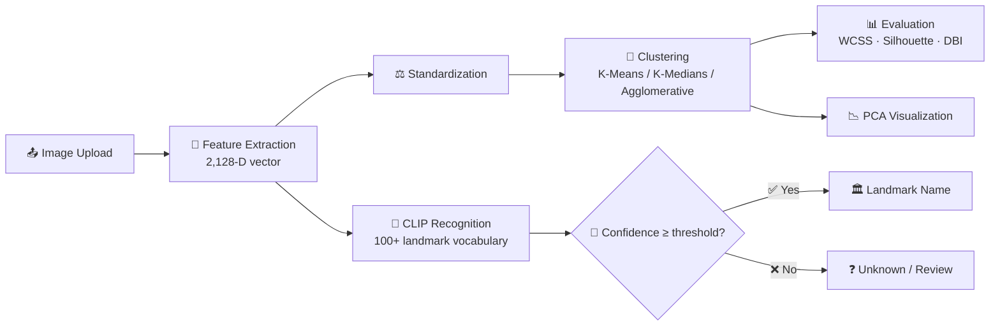

<div align="center">

# 🏛️✨ Landmark AI Studio ✨🏛️

### 📸 Landmark Photo Grouping by Visual Feature Similarity Using Clustering 🔍

*🤖 An advanced hybrid AI full-stack application for grouping, recognizing, and analyzing landmark photographs 🌍*

<br/>

[](https://reactjs.org/)
[](https://www.typescriptlang.org/)
[](https://tailwindcss.com/)
[](https://fastapi.tiangolo.com/)
[](https://pytorch.org/)
[](https://scikit-learn.org/)
[](https://www.docker.com/)

<br/>

🌐 [**Live Demo**](https://land-mark-ai.vercel.app) •
⚙️ [**Backend API**](https://landmark-ai-62dm.onrender.com/docs) •
🐛 [**Report Bug**](https://github.com/vineetoshKumar-vk/LandMark-AI/issues) •
💡 [**Request Feature**](https://github.com/vineetoshKumar-vk/LandMark-AI/issues)

</div>

---

## 📑 Table of Contents

- 📖 [Overview](#-overview)
- 📸 [Application Preview](#-application-preview)
- ✨ [Key Features](#-key-features)
- 🛠️ [Technology Stack](#️-technology-stack)
- ⚙️ [The ML Pipeline](#️-the-ml-pipeline)
- 🚀 [Getting Started](#-getting-started)
- 📊 [Evaluation Metrics](#-evaluation-metrics)
- 🗺️ [Roadmap](#️-roadmap)
- 👨‍💻 [Author](#-author)

---

## 📖 Overview

🏛️ **Landmark AI Studio** is a full-stack web application to explore landmark images 🖼️, extract deep visual features 🧬, group visually similar photos 🧩, and evaluate clustering quality 📏 using Machine Learning.

🌉 It bridges **Unsupervised Machine Learning** (finding patterns without labels 🔎) and **Zero-Shot Semantic Recognition** (naming those patterns 🏷️). A modern ⚛️ React dashboard talks to a scalable ⚡ FastAPI backend powered by 🧠 **ResNet-50** and 🤖 **CLIP**.

> [!IMPORTANT]
> ⚠️ Clustering discovers groups based on *visual similarity* 👀. A cluster number is **not** automatically a verified landmark name ❌. The system uses confidence thresholds 🎯 so that guesses are never presented as facts ✅.

---

## 📸 Application Preview

<!-- 🖼️ Replace the placeholders below with your real screenshots (put images in an `assets/` folder) -->

| 🏠 Dashboard | 🔍 Recognition Page |
| :---: | :---: |
|  |  |

| 📉 Cluster Visualization (PCA) | 📊 Evaluation Metrics |
| :---: | :---: |
|  |  |

---

## ✨ Key Features

| | Feature | Description |
| :-: | :-- | :-- |
| 📤 | **Multi-Image Upload** | 🖱️ Drag-and-drop upload for multiple landmark photos |
| 🧠 | **Hybrid Feature Extraction** | 🔗 Combines deep learning and classical computer-vision features |
| 🔢 | **Advanced Clustering** | ⚔️ Compare K-Means, K-Medians, and Agglomerative Hierarchical clustering |
| 📉 | **Dimensionality Reduction** | 🎨 PCA projects 2,128-D features into 2D/3D for visualization |
| 🤖 | **Semantic Recognition** | 🕌 CLIP identifies actual landmark names (e.g., Taj Mahal, Qutub Minar) |
| ❓ | **Unknown / Review Group** | 🛡️ Low-confidence predictions are safely set aside, not misidentified |
| 📊 | **Interactive Dashboard** | 📈 Recharts visuals for WCSS, Silhouette Score, and Davies-Bouldin Index |
| 🐳 | **Fully Dockerized** | ⚡ One command runs the frontend and backend anywhere |

---

## 🛠️ Technology Stack

| 🧱 Layer | 🧰 Technologies |
| :-- | :-- |
| 🎨 **Frontend** | ⚛️ React, ⚡ Vite, 🔷 TypeScript, 🌬️ Tailwind CSS, 📊 Recharts, 🪶 Lucide |
| ⚙️ **Backend** | 🐍 Python, 🚀 FastAPI, 🦄 Uvicorn |
| 🧠 **Machine Learning** | 🔥 PyTorch, 👁️ Torchvision, 🔬 scikit-learn, 🤗 Hugging Face (CLIP) |
| 🖼️ **Image Processing** | 🛏️ Pillow, 🔢 NumPy |
| ☁️ **Deployment** | 🐳 Docker, 🧩 Docker Compose, ▲ Vercel (frontend), 🟣 Render (backend) |

---

## ⚙️ The ML Pipeline



1. 📤 **Image Input**: upload images via the React dashboard.
2. 🧬 **Feature Extraction**: generates a **2,128-dimensional vector**:
   - 🧠 **ResNet-50**: 2,048 deep visual embeddings
   - 🎨 **RGB Histogram**: 64 color-distribution features
   - 🧵 **LBP Texture**: 16 local binary pattern features
3. ⚖️ **Preprocessing**: standardize and scale features for optimal clustering.
4. 🔢 **Clustering**: compare K-Means (Euclidean 📐), K-Medians (Manhattan 🏙️), and Agglomerative 🌳 methods.
5. 📏 **Evaluation**: compute WCSS/Inertia, Silhouette Score, and Davies–Bouldin Index.
6. 📉 **Visualization**: flatten high-dimensional data with PCA.
7. 🤖 **Recognition (CLIP)**: match visual features against a 100+ landmark text vocabulary 📚.

---

## 🚀 Getting Started

### 📋 Prerequisites

- 🐍 **Python 3.11+**
- 🟢 **Node.js 18+** and 📦 npm
- 🐳 **Docker Desktop** (recommended)

### 🐳 Method 1: Run with Docker (Recommended)

⚡ The easiest way to run the whole application (frontend + backend + AI models):

```bash
# 1️⃣ Clone the repository
git clone https://github.com/vineetoshKumar-vk/LandMark-AI.git
cd LandMark-AI

# 2️⃣ Build and start the containers
docker compose up --build
```

🎉 Once the build finishes, open the frontend in your browser (check `docker-compose.yml` for the exposed ports).

### 🛠️ Method 2: Run Manually

**⚙️ Backend**

```bash
cd backend
python -m venv venv
source venv/bin/activate        # Windows: venv\Scripts\activate
pip install -r requirements.txt
uvicorn main:app --reload
```

**🎨 Frontend**

```bash
cd frontend
npm install
npm run dev
```

> [!NOTE]
> 📝 Folder names and entry points above (`backend`, `frontend`, `main:app`) are assumptions. Adjust them to match your repository structure.

---

## 📊 Evaluation Metrics

| 📏 Metric | 💡 What it tells you | 🏆 Better when |
| :-- | :-- | :-- |
| 📉 **WCSS / Inertia** | Compactness of clusters (elbow method 💪) | ⬇️ Lower |
| 🎯 **Silhouette Score** | How well each point fits its own cluster vs. others | ⬆️ Higher (max 1) |
| 🧮 **Davies–Bouldin Index** | Average similarity between clusters | ⬇️ Lower |

---

## 🗺️ Roadmap

- [x] 📤 Multi-image upload and hybrid feature extraction
- [x] 🔢 K-Means, K-Medians, Agglomerative clustering
- [x] 🤖 CLIP-based zero-shot landmark recognition
- [x] 🐳 Dockerized deployment
- [ ] 📚 Larger landmark vocabulary
- [ ] 💾 Export clustering results (CSV / ZIP of grouped images)
- [ ] 🧪 Additional clustering algorithms (DBSCAN, HDBSCAN)

---

## 👨‍💻 Author

**🙋 Vineetosh Kumar**
🎓 B.Tech CSE (AI & ML), Lovely Professional University

[](https://github.com/vineetoshKumar-vk)

---

<div align="center">

⭐ **If you found this project useful, consider giving it a star!** ⭐

🏛️ Made with ❤️ and lots of ☕ by Vineetosh 🚀

</div>
