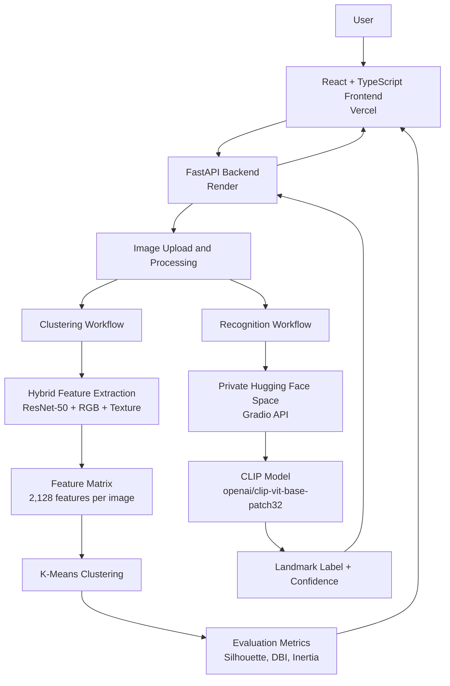

::: {align="center"}
# 🏛️ LandMark AI Studio

### Landmark Photo Recognition & Visual Similarity-Based Clustering

**Upload landmark photographs. Recognize what they show. Explore visual
similarities.**

[🌐 Live Application](https://land-mark-ai.vercel.app) · [💻 GitHub
Repository](https://github.com/vineetoshKumar-vk/LandMark-AI) · [⚙️
Backend Service](https://landmark-ai-62dm.onrender.com)

*An AI-powered full-stack application that combines landmark image
recognition with visual-feature-based photo clustering.*
:::📸 Application Preview
Add screenshots of your actual deployed application in the assets/
folder and update the paths below.

  Dashboard                              Landmark Recognition
     
  Clustering Results                       Model Evaluation
     
📌 Table of Contents
- Overview
- Problem Statement
- Project Objectives
- Key Features
- Live Demo and Deployment
- System Architecture
- Machine Learning Workflow
- Feature Engineering
- Landmark Recognition with CLIP
- Clustering and Evaluation
- Technology Stack
- Project Structure
- Installation and Local Setup
- Environment Variables and
  Security
- API and Service Communication
- Results and Testing
- Limitations
- Future Enhancements
- Contributing
- Author
📖 Overview
LandMark AI Studio is a full-stack AI/ML web application for working
with landmark photographs. It brings together two related but different
computer-vision workflows:
1. Landmark recognition: predicts the likely landmark shown in an
   uploaded image using a CLIP model hosted in a private Hugging Face
   Space.
2. Visual similarity clustering: extracts numerical visual features
   from photographs and groups images using a selected clustering
   algorithm.
The project combines deep visual representations with traditional image
features. It also provides clustering evaluation measures to help users
inspect the quality of the generated groups.
Two workflows, two different goals
  Workflow                Main question           Output
  Landmark Recognition    "Which landmark might   Predicted landmark name
this photograph show?"  and confidence score
Visual Clustering       "Which photographs look Cluster assignments and
visually similar?"      evaluation results
Important: A cluster ID is not a landmark identity. Clustering
groups images by feature similarity; recognition predicts a semantic
landmark label. A recognition confidence score is a model score and
should not automatically be interpreted as a calibrated probability.

🎯 Problem Statement
Large collections of landmark photographs can be difficult to organize
manually. Images of the same place may have different lighting, angles,
backgrounds, distances, and resolutions. At the same time, visually
similar buildings may belong to different locations.

This project explores how computer-vision features and machine-learning
methods can help:
- Analyze landmark photographs automatically.
- Represent images as numerical feature vectors.
- Group photographs based on visual similarity.
- Predict likely landmark names using a vision-language model.
- Evaluate clustering results with standard metrics.
- Provide an accessible web interface for experimentation.
🎯 Project Objectives
- Build a web interface for uploading and exploring landmark
  photographs.
- Extract useful visual information from each image.
- Combine deep-learning embeddings with color and texture descriptors.
- Apply clustering to discover groups of visually similar images.
- Evaluate clustering quality using Silhouette Score, Davies--Bouldin
  Index, and Inertia/Within-Cluster Sum of Squares (WCSS), where
  applicable.
- Integrate CLIP-based landmark recognition through a separately
  hosted inference service.
- Deploy the frontend, backend, and model inference service for online
  use.
✨ Key Features
📤 Image Upload and Management
- Upload landmark photographs through the web interface.
- Process multiple uploaded images in a clustering experiment.
- View uploaded image records and their processing status.
🧠 Hybrid Visual Feature Extraction
- Generate deep visual embeddings using ResNet-50.
- Extract RGB colour histogram descriptors.
- Extract texture descriptors.
- Combine the descriptors into a 2,128-dimensional feature vector
  per image.
🔢 Visual Similarity Clustering
- Run K-Means clustering.
- Choose the number of clusters for an experiment.
- Group photographs according to their extracted feature
  representations.
📊 Clustering Evaluation
- Silhouette Score.
- Davies--Bouldin Index.
- Inertia / WCSS for K-Means.
- Compare experiment results rather than relying on one metric alone.
🧩 Dimensionality Reduction and Visualization
- PCA (Principal Component Analysis) can be used to project
  high-dimensional feature data into a lower-dimensional space for
  visualization, where enabled in the application.
🤖 CLIP-Based Landmark Recognition
- Send uploaded images to a CLIP inference service hosted on Hugging
  Face.
- Display the predicted landmark name and confidence score.
- Use an Unknown / Review fallback when recognition cannot produce a
  usable result or when the application's review logic marks a result
  uncertain.
☁️ Deployed Application
- Frontend hosted on Vercel.
- FastAPI backend hosted on Render.
- CLIP inference hosted in a private Hugging Face Space.
🌐 Live Demo and Deployment
  Component                           Deployment
  Live Frontend                   https://land-mark-ai.vercel.app

  FastAPI Backend                 https://landmark-ai-62dm.onrender.com

  GitHub Repository               https://github.com/vineetoshKumar-vk/LandMark-AI
Hugging Face Model Space        Private Space: Vineetoshk/landmark-clip-inference
The Hugging Face Space is private and is accessed by the backend using a
read token stored as a deployment secret. The token is not included in
this repository.
Deployment note: The Render free instance may spin down after
inactivity, so the first request can take longer while the service
wakes up. Opening the backend root URL may return 404 Not Found if
no root route is defined; that response alone does not establish that
the API service is unavailable.

🏗️ System Architecture
The application uses a frontend/backend architecture with a separate
model-inference service.

Deployment responsibilities
- Vercel: serves the user-facing frontend.
- Render: runs the Python FastAPI backend, handles application
  requests, and coordinates processing.
- Hugging Face Spaces: hosts the CLIP model and exposes its Gradio
  prediction API.
- Gradio Client: allows the backend to call the private Hugging
  Face Space programmatically.
🧪 Machine Learning Workflow
The application has separate recognition and clustering paths.
Workflow A --- Visual Similarity Clustering
1. Image input: the user uploads landmark photographs.
2. Image processing: images are opened and prepared for feature
   extraction.
3. Feature extraction: deep, colour, and texture descriptors are
   calculated.
4. Feature combination: descriptors are combined into a
   2,128-dimensional representation.
5. Preprocessing: feature scaling/standardization is applied where
   configured for the experiment.
6. Clustering: K-Means assigns images to clusters based on the
   selected configuration.
7. Evaluation: applicable clustering metrics are calculated.
8. Visualization: the application displays the experiment results
   and available visual analysis.
Workflow B --- Landmark Recognition
1. The user requests landmark recognition for uploaded photographs.
2. The FastAPI backend obtains an authenticated client for the private
   Hugging Face Space.
3. The backend sends the image to the Gradio API endpoint
   /recognize_landmark.
4. The CLIP model evaluates the image against the candidate landmark
   labels configured by the inference application.
5. The inference service returns a landmark label and confidence score.
6. The backend sends the prediction to the frontend for display.
🧬 Feature Engineering
The clustering workflow combines three types of image features.
  Feature family                          Dimensions What it represents
  ResNet-50 embedding                          2,048 High-level visual
patterns learned by a
convolutional neural
network

  RGB colour histogram                            64 Distribution of
colour information in
the image

  Texture descriptors                             16 Local texture
patterns and surface
characteristics
Combined feature                       2,128 Complete numerical
vector                                           representation used
for clustering
Feature-vector calculation
ResNet-50 embedding       = 2048 dimensions
RGB colour histogram     =   64 dimensions
Texture descriptors      =   16 dimensions
                         ------------------
Combined feature vector  = 2128 dimensions
For eight successfully processed images, the feature matrix shape is:
(8, 2128)
This means the matrix contains eight rows (one per image) and 2,128
feature columns.
Why combine these features?
- Deep embeddings capture complex visual structures and semantic
  patterns.
- Colour histograms describe the overall colour distribution.
- Texture descriptors capture local visual texture information.
Combining them gives the clustering algorithm more than one type of
visual signal. The contribution of each feature family can depend on
preprocessing and scaling.
🤖 Landmark Recognition with CLIP
The recognition workflow uses:

Model: openai/clip-vit-base-patch32

CLIP is a vision-language model that learns relationships between images
and text. In a zero-shot classification-style workflow, an image can be
compared with a set of candidate text descriptions or landmark labels
without training a separate classifier for every label.
Recognition service details
- Model hosting: private Hugging Face Space.
- Inference interface: Gradio.
- Backend integration: gradio_client.
- API endpoint: /recognize_landmark.
- Authentication: Hugging Face read token stored in the backend
  environment as HF_TOKEN.
- Response fields used by the backend:
  - landmark
  - confidence
Example response shape
{
  "landmark": "India Gate",
  "confidence": 0.9892
}
The values above illustrate the response format; actual predictions and
scores depend on the uploaded image and model output.
Unknown / Review
The application can return Unknown / Review when recognition fails or
the application's review rules do not accept a prediction. This is
preferable to presenting every uncertain result as a confirmed landmark.
📈 Clustering and Evaluation
K-Means
K-Means is an unsupervised clustering algorithm. It divides feature
vectors into a selected number of clusters by assigning each sample to a
cluster centroid and updating the centroids iteratively.

High-level process:
1. Choose the number of clusters, K.
2. Initialize K centroids.
3. Assign each image feature vector to its nearest centroid.
4. Recalculate centroids.
5. Repeat assignment and update steps until the algorithm converges or
   reaches its stopping condition.
The cluster number identifies a group; it does not itself identify a
real-world landmark.
Evaluation Metrics
  Metric                  What it measures        General interpretation
  Silhouette Score    Cohesion within a       Higher is generally
cluster compared with   better; values range
separation from other   from -1 to 1
clusters                

  Davies--Bouldin       Similarity between each Lower is generally
Index                 cluster and its most    better
similar other cluster   
Inertia / WCSS      Sum of squared          Lower means tighter
distances between       clusters, but it
samples and their       usually decreases as K
assigned K-Means        increases
centroids
Important evaluation notes
- Do not choose a cluster count using inertia alone.
- Compare multiple metrics and inspect the actual image groups.
- Silhouette and Davies--Bouldin calculations require valid cluster
  assignments and may not be meaningful for every experiment.
- Inertia is associated with centroid-based K-Means clustering and
  should not be presented as a universal metric for every clustering
  algorithm.
- Do not report an accuracy percentage for unsupervised clustering
  unless a separate, valid ground-truth evaluation has been performed.
🛠️ Technology Stack
  Layer                   Technologies            Purpose
  Frontend                React, Vite, TypeScript Interactive web
interface

  Styling and UI          Tailwind CSS, Lucide    Layout, styling, and
icons                   icons

  Charts                  Recharts                Visual presentation of
experiment metrics

  Backend                 Python, FastAPI,        API endpoints and
Uvicorn                 application logic

  Deep visual features    PyTorch, Torchvision,   Image embeddings for
ResNet-50               clustering

  Recognition             Hugging Face CLIP       Image-to-text semantic
matching

  Model serving           Hugging Face Spaces,    Remote model inference
Gradio                  

  Backend integration     gradio_client         Authenticated calls to
the Gradio API

  Image processing        Pillow, NumPy           Image loading and
numerical operations

  Machine learning        Scikit-learn            Clustering,
preprocessing, and
evaluation
Deployment              Vercel, Render, Hugging Hosting the application
Face Spaces             components
📁 Project Structure
The following is a high-level guide to the known backend and application
components. Exact filenames may differ in the current repository.
LandMark-AI/
│
├── backend/
│   ├── app/
│   │   └── ml/
│   │       └── recognition_service.py
│   ├── uploads/
│   ├── main.py
│   ├── requirements.txt
│   └── Dockerfile
│
├── frontend/
│   ├── src/
│   ├── public/
│   └── package.json
│
├── README.md
└── .gitignore
- backend/main.py --- FastAPI application entry point.
- backend/app/ml/recognition_service.py --- connects to the private
  Hugging Face Space and requests landmark predictions.
- backend/requirements.txt --- Python dependencies.
- frontend/ --- React and TypeScript user interface.
This is an illustrative high-level structure. Keep it synchronized
with the actual folders and files in the repository. Do not create
empty folders just to match this diagram.

🚀 Installation and Local Setup
Prerequisites
Install the following tools:
- Python 3.11 or a compatible version used by the backend.
- Node.js and npm.
- Git.
- A Hugging Face read token with access to the private inference
  Space.
- Docker Desktop only if you plan to use the repository's Docker
  configuration.
1. Clone the repository
git clone https://github.com/vineetoshKumar-vk/LandMark-AI.git
cd LandMark-AI
2. Set up the backend
cd backend

# Create a virtual environment
python -m venv .venv

# Windows
.venv\Scripts\activate

# Install Python dependencies
pip install -r requirements.txt
If you are using macOS/Linux, activate the environment with:
source .venv/bin/activate
3. Configure the Hugging Face token
Set HF_TOKEN in your local environment before starting the backend.

Windows PowerShell:
$env:HF_TOKEN="your_hugging_face_read_token"
Windows Git Bash:
export HF_TOKEN="your_hugging_face_read_token"
Do not paste your real token into this README or commit it to GitHub.
4. Start the backend
From the backend directory, the typical command for the current
application layout is:
uvicorn main:app --reload --host 0.0.0.0 --port 8001
If your local import path or startup configuration differs, use the
command configured by the repository's Dockerfile or deployment
settings.
5. Set up and start the frontend
Open another terminal and navigate to the actual frontend directory (for
example, frontend/):
npm install
npm run dev
Use the development URL printed by Vite in your terminal. If the
frontend uses a different directory or script, follow its
package.json.
6. Connect frontend and backend
Make sure the frontend API base URL points to the local FastAPI backend
during local development, and to the deployed Render backend in
production.
🐳 Docker
The backend deployment on Render uses a Docker build. If the repository
contains a valid docker-compose.yml configured for the services you
want to run locally, you can start those services with:
docker compose up --build
Stop the containers with:
docker compose down
The live frontend, FastAPI backend, and Hugging Face inference Space
are deployed as separate services. Do not assume one Docker Compose
command starts the complete production deployment unless the Compose
configuration explicitly defines all required services.

🔐 Environment Variables and Security
  Variable                Required for            Description
  HF_TOKEN              Backend recognition     Hugging Face read token
service                 used to access the
private Space
Security best practices
- Store HF_TOKEN in Render's Environment settings for production.
- Use a local environment variable for development.
- Never hardcode access tokens in Python or frontend source code.
- Never commit .env files, credentials, or private keys.
- If a token is accidentally exposed, revoke it and create a
  replacement.
- Keep the Hugging Face Space private if private access is required.
🔌 API and Service Communication
The backend communicates with the Hugging Face Space through
gradio_client.

The recognition service uses:
client.predict(
    image=handle_file(image_path),
    api_name="/recognize_landmark"
)
The expected response is a dictionary containing a landmark label and
confidence score.

Example:
{
    "landmark": "India Gate",
    "confidence": 0.9892
}
The backend validates the response and returns a fallback result if the
recognition request raises an exception. Check the Render logs when
investigating failed recognition requests.
🧾 Results and Testing
The deployed recognition pipeline has been tested successfully by
uploading landmark photographs through the live frontend. The backend
connected to the private Hugging Face Space and returned landmark
predictions with confidence scores.

The clustering workflow has also successfully processed an eight-image
test batch. The observed feature matrix shape was:
Feature matrix shape: (8, 2128)
The K-Means endpoint returned:
POST /cluster?algorithm=kmeans&n_clusters=2
200 OK
These are observed integration-test outputs, not a claim of overall
model accuracy.
Suggested test checklist
- [ ] Upload one valid landmark image.
- [ ] Verify the recognition label and confidence score.
- [ ] Test images of different landmarks and viewpoints.
- [ ] Check how uncertain or unsupported images are handled.
- [ ] Upload multiple images for feature extraction.
- [ ] Confirm the feature matrix dimensions.
- [ ] Run K-Means with different cluster counts.
- [ ] Review the generated groups visually.
- [ ] Record Silhouette Score, Davies--Bouldin Index, and Inertia
  where applicable.
- [ ] Test the application after the hosted services have been idle.
⚠️ Limitations
- Recognition quality depends on the model, candidate landmark labels,
  image quality, and viewpoint.
- A confidence score is not necessarily a calibrated probability of
  correctness.
- Similar-looking landmarks may be confused by a vision model.
- Clustering results depend on the feature representation,
  preprocessing, scaling, and selected algorithm parameters.
- A visually similar cluster may contain photographs of different
  real-world landmarks.
- Small image batches may not provide enough data for meaningful
  clustering conclusions.
- The first request to a free Render service may be delayed while the
  instance wakes from inactivity.
- A private Hugging Face Space requires a valid read token and may be
  affected by model availability or inference limits.
🔮 Future Enhancements
- Expand the landmark dataset with more geographic and architectural
  diversity.
- Evaluate recognition using a labelled test set and report
  appropriate metrics.
- Improve confidence calibration and review thresholds.
- Compare additional clustering algorithms when implemented and
  validated.
- Perform systematic experiments with different cluster counts and
  feature-scaling strategies.
- Improve PCA-based 2D/3D visualizations.
- Add representative images and descriptive summaries for each
  cluster.
- Add automated backend and frontend tests.
- Add API monitoring, structured logging, and clearer user-facing
  error messages.
- Improve accessibility, responsiveness, and user experience.
🤝 Contributing
Contributions, suggestions, and issue reports are welcome.
1. Fork the repository.
2. Create a feature branch.
3. Make your changes and test them.
4. Commit your changes with a clear message.
5. Open a Pull Request describing the improvement.
👨‍💻 Author
Vineetosh Kumar
B.Tech -- Computer Science and Engineering (AI & ML)
Lovely Professional University
- GitHub:
  vineetoshKumar-vk
- Project Repository:
  LandMark-AI
- Live Application:
  land-mark-ai.vercel.app
::: {align="center"}
### ⭐ If you find this project interesting, consider giving the repository a star!

**LandMark AI Studio --- Recognize landmarks. Discover visual
similarities.**
:::
